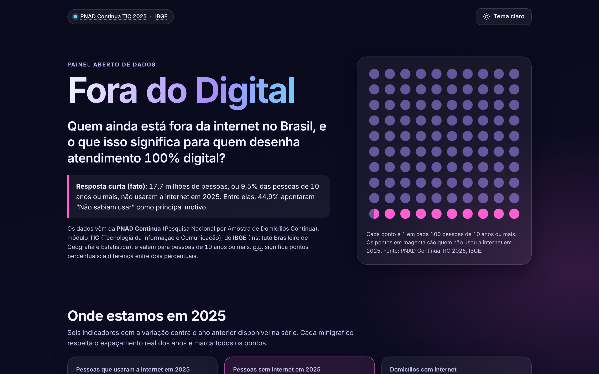

# Fora do Digital

Painel aberto, em HTML, CSS e JavaScript puros, que mostra quem ainda está fora da internet no Brasil com dados da PNAD Contínua TIC 2025 do IBGE.



## A pergunta

**Quem ainda está fora da internet no Brasil, e o que isso significa para quem desenha atendimento 100% digital?**

A PNAD Contínua (Pesquisa Nacional por Amostra de Domicílios Contínua) é a pesquisa do IBGE (Instituto Brasileiro de Geografia e Estatística) que mede o acesso à internet. O módulo TIC (Tecnologia da Informação e Comunicação) cobre pessoas de 10 anos ou mais. Neste texto, p.p. significa pontos percentuais, a diferença entre dois percentuais.

## Quatro achados

1. **17,7 milhões de pessoas não usaram a internet em 2025**, ou 9,5% das pessoas de 10 anos ou mais. Em 2019 eram 36,7 milhões (20,6%). Fonte: IBGE, PNAD Contínua TIC 2025.
2. **A distância entre urbano e rural caiu de 37,5 p.p. para 8,5 p.p.** O uso rural foi de 33,9% (2016) para 83,0% (2025) e o urbano, de 71,4% para 91,5%. Os pontos de 2016 e 2023 vêm do informativo de 2024. Fonte: IBGE, PNAD Contínua TIC 2025 e 2024.
3. **44,9% de quem não usa internet disse que não sabia usar.** É o principal motivo, à frente da falta de necessidade (27,8%) e do custo do serviço ou equipamento (9,0%). Fonte: IBGE, PNAD Contínua TIC 2025.
4. **A lacuna se concentra em alguns grupos.** Entre pessoas de 60 anos ou mais, 74,5% usaram a internet (25,5% ficaram fora). Entre pessoas sem instrução, 50,1%, contra 97,4% entre quem tem ensino superior completo. Fonte: IBGE, PNAD Contínua TIC 2025.

## O que o painel mostra

- Indicadores principais com tendência: pessoas que usaram a internet, pessoas sem internet (em milhões e em percentual), domicílios com internet, pessoas com celular para uso pessoal e pessoas de 60 anos ou mais online.
- Evolução do uso da internet nas áreas urbana e rural.
- Recortes de 2025 por região, área, idade, instrução, sexo e cor ou raça, um de cada vez.
- Motivos para não usar a internet, de pessoas e de domicílios, e motivos para não ter celular.
- Finalidades de uso da internet e equipamentos usados para acessar.
- Destaque com o rendimento médio mensal real per capita dos domicílios com e sem internet.
- Simulador "Sua base de clientes", tabela alternativa em cada gráfico e download dos dados em CSV.

Todas as fontes são publicações do IBGE.

## Como rodar

Abra o arquivo `index.html` com duplo clique. Não precisa de servidor, instalação nem internet.

Se preferir um servidor local, ou for publicar no GitHub Pages:

```
python3 -m http.server 8000
```

Depois acesse `http://localhost:8000`.

## Como atualizar os dados

1. Edite `data/pnad_tic.json`. Cada série, recorte e bloco precisa de uma `fonte` que exista em `fontes`.
2. Gere o arquivo lido pelo painel:

```
python3 scripts/gerar_dados.py
```

3. Valide o JSON e rode os testes:

```
python3 scripts/validar_dados.py
python3 -m unittest discover -s tests -v
```

O CI repete esses passos e confere, com `python3 scripts/gerar_dados.py --check`, que `data/dados.js` está atualizado.

## Estrutura

```
index.html                  página do painel
assets/estilo.css           tema escuro e claro, layout responsivo
assets/painel.js            gráficos em SVG, simulador, tabelas e CSV
data/pnad_tic.json          dados transcritos do IBGE, com fonte por série
data/dados.js               gerado a partir do JSON (window.DADOS)
scripts/gerar_dados.py      valida, calcula derivados e gera dados.js
scripts/validar_dados.py    regras de qualidade dos dados
tests/test_dados.py         testes do validador e do gerador
docs/METODOLOGIA.md         como cada número foi obtido e calculado
.github/workflows/          CI que valida dados e testes
```

## Decisões técnicas

- **JavaScript puro, sem framework e sem CDN.** O painel tem poucas telas e nenhuma dependência para manter. Funciona offline e continua funcionando daqui a anos.
- **`data/dados.js` gerado do JSON.** Navegadores bloqueiam `fetch` de arquivos locais, então um `window.DADOS` carregado por `<script>` permite abrir a página por duplo clique. O JSON continua sendo a fonte de verdade, e o CI barra um `dados.js` desatualizado.
- **Gráficos SVG desenhados à mão.** O eixo respeita o espaçamento real dos anos, séries com anos faltantes têm trechos tracejados, valores nulos viram lacuna e o foco, o tooltip e o teclado seguem o comportamento definido pelo projeto.
- **Cálculos em Python, leitura em JavaScript.** Variações, gaps e percentuais de quem está fora são calculados e testados no gerador. O navegador só exibe.
- **Tema escuro por padrão.** A preferência de tema é salva em `localStorage`, com tratamento de erro caso o navegador bloqueie o armazenamento.

## Limitações

- A PNAD Contínua é uma pesquisa por amostra. Os percentuais têm margem de erro que o informativo não traz em todas as quebras.
- O IBGE revisa a série a cada divulgação. Os pontos de 2016 (urbano e rural) e de 2023 vêm do informativo de 2024 e podem diferir da série revisada. Eles aparecem com marcador vazado.
- A série de percentual de pessoas não tem todos os anos entre 2016 e 2025. Os anos sem dado não são interpolados.
- Os recortes (região, área, idade, instrução, sexo, cor ou raça) são mostrados um de cada vez. Não dá para combinar perfis sem os microdados.
- Idade, instrução e cor ou raça são listas parciais, com as categorias que constam nos dados do projeto.
- O simulador "Sua base de clientes" é uma estimativa simples e não conhece a composição real de uma base.
- As leituras para atendimento são recomendações do projeto, não resultados da pesquisa.

Mais detalhes em [docs/METODOLOGIA.md](docs/METODOLOGIA.md).

## Por que este projeto

Quem desenha atendimento decide, muitas vezes, quais canais existem e quais saem do ar. Esse tipo de decisão costuma usar a média de quem já está conectado. Eu trabalho com atendimento e ouvidoria há mais de 5 anos e estou em transição para Dados, BI e IA. Este painel junta os dois lados: um dado público bem tratado e uma pergunta que quem atende pessoas precisa responder antes de tornar um canal 100% digital.

## Fontes

- IBGE, PNAD Contínua: Acesso à Internet e à televisão e posse de telefone móvel celular para uso pessoal 2025 (informativo). Referência: 4º trimestre de 2025. Divulgação: 02/07/2026. [Documento](https://biblioteca.ibge.gov.br/visualizacao/livros/liv102290_informativo.pdf)
- IBGE, PNAD Contínua: Acesso à Internet e à televisão e posse de telefone móvel celular para uso pessoal 2024 (informativo). Referência: 4º trimestre de 2024. [Documento](https://biblioteca.ibge.gov.br/visualizacao/livros/liv102193_informativo.pdf)

## Licença

MIT. Veja [LICENSE](LICENSE). Os dados pertencem ao IBGE.

## Autor

**Diego Arruda** · [LinkedIn](https://www.linkedin.com/in/drasdiego) · [GitHub](https://github.com/drasdiego)
